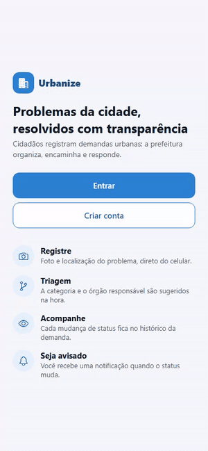
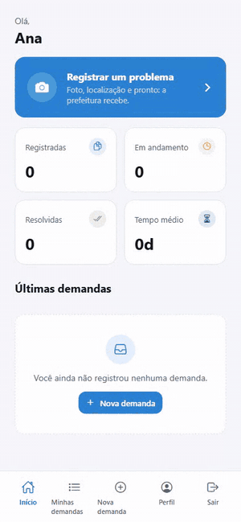
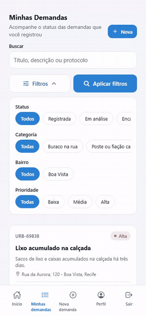
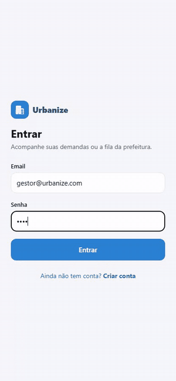
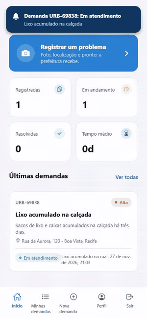

# Urbanize

App para registrar e acompanhar problemas urbanos (buraco na rua, poste caído, lixo
acumulado). O cidadão fotografa o problema e marca o local pelo GPS; a prefeitura recebe a
demanda já classificada, encaminha ao órgão responsável e atualiza o status. A cada mudança
de status, o cidadão recebe uma notificação.

O projeto tem duas partes:

- `mobile/`: app em Expo (React Native) com TypeScript, expo-router, Zustand e NativeWind.
  Roda no Android, no iOS e no navegador.
- `backend/`: API REST em Node.js com Express, Prisma (SQLite), JWT, Redis opcional e
  envio de push pelo Expo.

## Demonstração

| Cadastro | Registro com foto e GPS | Acompanhamento e filtros |
| :---: | :---: | :---: |
|  |  |  |

| Gestor atualiza o status | Cidadão é notificado |
| :---: | :---: |
|  |  |

Vídeo do fluxo completo (31 s): [docs/media/demo-fluxo-completo.mp4](docs/media/demo-fluxo-completo.mp4).

Os GIFs e o vídeo saem do teste E2E do fluxo completo, gravado na versão web. Para gerá-los de
novo depois de mudar a interface, rode `npm run demo:gifs` em `e2e/` (detalhes em
[e2e/README.md](e2e/README.md)).

## Funcionalidades

**Cidadão**

- Cria a conta pelo app (o cadastro público só cria cidadãos).
- Registra demandas com foto (câmera ou galeria), localização do GPS, categoria e prioridade.
  A foto passa por uma triagem que sugere a categoria e o órgão responsável.
- Acompanha as próprias demandas, com busca e filtros por status, categoria, bairro e
  prioridade, e vê o histórico de cada uma.
- Recebe notificação quando o gestor muda o status.
- Consulta as demandas já abertas mesmo sem internet (cache local).

**Gestor público**

- Painel com total de demandas, contagem por status, distribuição por categoria e tempo
  médio de atendimento.
- Fila de triagem: aceita a sugestão automática ou abre a demanda para revisar.
- Altera o status com uma observação, que entra no histórico e dispara a notificação.

Contas de demonstração (criadas pelo seed):

| Perfil | Email | Senha |
| --- | --- | --- |
| Cidadão | `cidadao@urbanize.com` | `demo` |
| Gestor | `gestor@urbanize.com` | `demo` |

## Como rodar

Pré-requisitos: Node.js 22 ou superior e npm. Para o caminho com Docker, Docker Desktop (ou
Docker Engine com Compose). Para testar no celular, o app Expo Go.

### Com Docker

```bash
./scripts/up.sh        # no Windows: bash scripts/up.sh (Git Bash ou WSL2)
```

O script gera `backend/.env`, `mobile/.env` e `docker/.env` (com o IP da máquina na rede local
e um `JWT_SECRET` aleatório), sobe os containers, aplica as migrations e popula o banco.

| Serviço | Endereço | Conteúdo |
| --- | --- | --- |
| `mobile` | http://localhost:8081 | App no navegador e Metro para o Expo Go |
| `backend` | http://localhost:4000/api | API REST; documentação em `/api/docs` |
| `redis` | `localhost:6379` | Cache das métricas |

O QR code para abrir o app no Expo Go aparece em
`docker compose -f docker/docker-compose.yml logs mobile`. O celular precisa estar na mesma
rede Wi-Fi da máquina.

```bash
./scripts/down.sh      # para os containers
./scripts/down.sh -v   # para e apaga os volumes (banco e dependências)
```

O passo a passo para Linux, macOS e Windows, com solução de problemas, está em
[docs/guia-instalacao.md](docs/guia-instalacao.md).

### Sem Docker

Backend, em um terminal:

```bash
cd backend
npm install
cp .env.example .env           # PowerShell: Copy-Item .env.example .env
npx prisma generate
npm run db:migrate             # cria backend/dev.db e aplica as migrations
npm run db:seed                # usuários, órgãos e demandas de demonstração
npm run dev                    # http://localhost:4000/api
```

App, em outro terminal:

```bash
cd mobile
npm install
cp .env.example .env           # ajuste EXPO_PUBLIC_API_URL, ver abaixo
npm start                      # w = navegador, a = emulador Android, QR = Expo Go
```

`EXPO_PUBLIC_API_URL` precisa ser um endereço que o aparelho alcance:

| Onde o app roda | Valor |
| --- | --- |
| Navegador ou simulador iOS | `http://127.0.0.1:4000/api` |
| Emulador Android | `http://10.0.2.2:4000/api` |
| Celular na mesma rede | `http://<IP-da-máquina>:4000/api` |

O valor entra no bundle quando o Metro inicia. Depois de mudar, reinicie com
`npx expo start --clear`.

## Variáveis de ambiente

### Backend (`backend/.env`)

| Variável | Obrigatória | Padrão | Para que serve |
| --- | --- | --- | --- |
| `DATABASE_URL` | sim | `file:./dev.db` | Arquivo SQLite usado pelo Prisma |
| `JWT_SECRET` | sim | (nenhum) | Assina os tokens de sessão e os links das fotos. Em produção, 32+ caracteres aleatórios (`openssl rand -hex 32`) |
| `JWT_EXPIRES_IN` | não | `15m` | Validade do token de acesso; a sessão se renova pelo refresh token |
| `REFRESH_TOKEN_TTL_DAYS` | não | `7` | Validade do refresh token |
| `BACKEND_PORT` | não | `4000` | Porta HTTP (o Render usa `PORT`) |
| `BACKEND_HOST` | não | `0.0.0.0` | Interface de rede; `0.0.0.0` aceita conexões do celular |
| `FRONTEND_URL` | em produção | (vazio) | Origens liberadas no CORS, separadas por vírgula |
| `AUTH_COOKIE_NAME` | não | `urbanize_session` | Cookie de sessão para clientes web |
| `REDIS_URL` | não | (vazio) | Liga o cache das métricas (sem ela o cache é desligado) |
| `METRICS_CRON` | não | `*/15 * * * *` | Frequência do snapshot de métricas |
| `RETENTION_MONTHS` / `RETENTION_CRON` | não | `12` / `0 3 * * *` | LGPD: após quantos meses o contato de demandas encerradas é anonimizado, e quando a rotina roda |
| `UPLOAD_URL_TTL_SECONDS` | não | `3600` | Validade dos links assinados das fotos |
| `GOOGLE_VISION_CREDENTIALS` | não | (vazio) | JSON da conta de serviço do Google Vision. Sem ela, a triagem usa a categoria escolhida no app |
| `BACKUP_ENCRYPTION_KEY` | não | (vazio) | Chave do backup diário cifrado (`openssl rand -hex 32`). Sem ela o backup não roda |
| `BACKUP_DIR` / `BACKUP_OFFSITE_DIR` / `BACKUP_CRON` | não | `./backups` / (vazio) / `0 2 * * *` | Onde e quando o backup é gravado |
| `SEED_GESTOR_EMAIL` / `SEED_GESTOR_SENHA` | em produção | (vazio) | Primeiro gestor criado pelo seed em produção, onde as contas de demonstração não existem |
| `PUSH_NOTIFICATIONS` | não | `true` | `false` desliga o envio de push |
| `TRUST_PROXY` / `REQUIRE_HTTPS` | não | `1` / `true` em produção | Comportamento atrás de proxy com TLS |

### App (`mobile/.env`)

| Variável | Para que serve |
| --- | --- |
| `EXPO_PUBLIC_API_URL` | Endereço da API (ver tabela acima). Nos builds do EAS vem do `eas.json` |

### Docker (`docker/.env`)

`HOST_LAN_IP` (IP usado pelo Expo Go), `BACKEND_PORT`, `METRO_PORT`, `REDIS_PORT` e, para
publicar com HTTPS pelo Caddy, `API_DOMAIN` e `BACKEND_BIND=127.0.0.1`. O
`scripts/setup-env.sh` preenche os valores locais.

## Banco de dados

O backend usa SQLite pelo Prisma. O schema fica em `backend/prisma/schema.prisma` e as
migrations em `backend/prisma/migrations/`.

| Comando (em `backend/`) | O que faz |
| --- | --- |
| `npm run db:migrate` | Aplica as migrations pendentes (e cria uma nova se o schema mudou) |
| `npx prisma migrate deploy` | Aplica as migrations sem criar novas (CI e produção) |
| `npm run db:seed` | Cria os usuários de demonstração, os órgãos e algumas demandas |
| `npm run db:studio` | Abre o Prisma Studio para ver e editar os dados |
| `npx prisma migrate reset` | Apaga o banco, reaplica as migrations e roda o seed |

Tabelas principais: `User` (perfil `cidadao` ou `gestor`), `Demand` e `DemandHistory`
(histórico de status), `Organ` (órgãos e categorias que atendem), `PushToken` (aparelhos
para notificação) e `MetricsSnapshot` (consolidação periódica).

## Documentação da API

Com o backend rodando, a documentação interativa (Swagger UI) fica em
**http://localhost:4000/api/docs**. Para chamar rotas autenticadas, faça login em
`POST /auth/login`, copie o `token` e use o botão *Authorize*.

A especificação OpenAPI está em [`backend/openapi.yaml`](backend/openapi.yaml) e também é
servida em `/api/docs/openapi.json`. Para usar no Postman ou no Insomnia, importe esse
arquivo ou a URL (*Import > File/URL*): as coleções são geradas a partir dele.

Resumo das rotas:

| Método e rota | Quem pode | Descrição |
| --- | --- | --- |
| `POST /auth/register` | público | Cadastro de cidadão |
| `POST /auth/login` | público | Login; devolve o JWT |
| `GET /auth/me` / `POST /auth/logout` | autenticado | Sessão atual / logout |
| `GET /demands` | autenticado | Lista com filtros `status`, `categoria`, `prioridade`, `bairro`, `busca` |
| `POST /demands` | autenticado | Registra uma demanda |
| `GET /demands/:id` | dono ou gestor | Detalhe com histórico |
| `PATCH /demands/:id/status` | gestor | Muda o status e notifica o cidadão |
| `POST /upload/image` | autenticado | Envia a foto e devolve a triagem |
| `GET /metrics/summary` | autenticado | Indicadores (do usuário ou gerais, para o gestor) |
| `GET /organs` | autenticado | Órgãos e categorias atendidas |
| `POST`/`DELETE /notifications/token` | autenticado | Registra ou remove o aparelho para push |

## Notificações

O fluxo segue registrar, acompanhar e notificar:

1. Depois do login, o app pede permissão de notificação e registra o token Expo Push do
   aparelho em `POST /notifications/token`.
2. Quando o gestor muda o status, o backend envia o push para os aparelhos do autor da
   demanda. Tocar na notificação abre a demanda.
3. O Expo Go e os emuladores não recebem push remoto. Nesses casos o app sincroniza a cada
   30 segundos e ao voltar para o primeiro plano, compara os status com o cache local e
   dispara uma notificação local. Na web, o aviso aparece dentro do app.

O push remoto exige um build com `projectId` do EAS (ver abaixo) rodando em aparelho físico.

## Modo offline

Cada lista e cada detalhe consultados ficam salvos no AsyncStorage, separados por usuário.
Sem conexão, o app mostra esses dados com o aviso "Sem conexão" e aplica os mesmos filtros
da API. O token de sessão fica no SecureStore (Keychain ou Keystore) e a sessão sobrevive
ao fechamento do app. O logout apaga o cache.

## Build e atualizações (EAS)

A configuração está em [`mobile/eas.json`](mobile/eas.json). Os perfis `preview` e
`production` geram APK instalável e apontam para a API do Render.

```bash
cd mobile
npx eas-cli login
npx eas-cli init               # cria o projeto no EAS e grava o projectId no app.json
npx eas-cli update:configure   # liga o expo-updates ao projeto
npm run build:apk              # build Android (perfil preview), gera o link do APK
```

O APK pode ser instalado no celular pelo link ou QR code que o EAS mostra ao final, ou no
emulador arrastando o arquivo para a janela. Para iOS, `npx eas-cli build -p ios --profile preview`
gera um build para o simulador.

Atualizações OTA: mudanças só de JavaScript chegam aos builds já instalados com
`npm run update:preview` (ou `update:production`). O app baixa a atualização ao abrir e
mostra uma faixa "Reiniciar". A política de `runtimeVersion` é `appVersion`, então uma
mudança nativa (plugin, permissão, SDK) exige novo build e novo `version` no `app.json`.

## Testes

| Nível | Onde | Comando |
| --- | --- | --- |
| Unitários do app | `tests/unit/` | `npm test` em `mobile/` |
| API (Jest + Supertest) | `tests/acceptance/` | `npm test` em `backend/` |
| BDD (Cucumber) | `tests/bdd/` | `npm run test:bdd` em `backend/` |
| E2E na versão web (Playwright) | `e2e/tests/` | `npm test` em `e2e/` (backend e app rodando) |

O E2E `fluxo-completo.spec.ts` percorre o caminho inteiro: cadastro, demanda com foto e GPS,
filtros, mudança de status pelo gestor e notificação ao cidadão. A pipeline do GitHub
Actions (`.github/workflows/regressao.yml`) roda unitários e API a cada push e os E2E
marcados com `@smoke` nos pull requests. Mais detalhes em
[docs/tests/organizacao-e-execucao.md](docs/tests/organizacao-e-execucao.md).

## Estrutura

```
mobile/
  app/                  rotas (expo-router): telas públicas e o grupo (app) autenticado
  src/components/       componentes de interface (NativeWind)
  src/hooks/            useAuth, useDemands, useMetrics, useNotifications, useOtaUpdate, useRoleGuard
  src/services/         cliente HTTP, serviços por domínio, cache offline, notificações, sessão
  src/store/            stores Zustand: auth, demand, metrics, notice
  src/types/            tipos compartilhados
  src/theme/            tokens de cor e espaçamento (lidos também pelo Tailwind)
  eas.json              perfis de build

backend/
  openapi.yaml          especificação da API
  prisma/               schema, migrations e seed
  src/routes/           rotas Express
  src/controllers/      validação de entrada (zod) e resposta HTTP
  src/services/         regras de negócio, triagem, métricas, notificações
  src/repositories/     acesso ao banco
  src/middlewares/      autenticação, upload, HTTPS, rate limit, erros

tests/                  unitários, API e BDD
e2e/                    testes ponta a ponta e geração dos GIFs
docker/                 Dockerfiles, compose e proxy Caddy
docs/                   documentação do projeto
```

## Deploy

O backend está no Render: https://urbanize-backend.onrender.com/api/health. No plano
gratuito o serviço dorme sem uso; abra o link e espere cerca de um minuto antes de testar.

Em produção (`NODE_ENV=production`) a API recusa requisições sem HTTPS e exige um
`JWT_SECRET` forte. Para hospedar em servidor próprio com TLS, o compose tem um perfil com
o Caddy:

```bash
# docker/.env: API_DOMAIN=api.seudominio.com  BACKEND_BIND=127.0.0.1
docker compose -f docker/docker-compose.yml --profile tls up -d
```

As fotos em `/uploads` só abrem pelo link assinado que a API devolve em `imagemUrl`. O acesso
direto ao arquivo retorna 403.

## Documentação do projeto

- [Guia de instalação](docs/guia-instalacao.md)
- [Plano de testes](docs/tests/plano-de-testes.md) e [como rodar cada nível](docs/tests/organizacao-e-execucao.md)
- [Requisitos de segurança e LGPD](docs/requisitos-seguranca.md) e [verificação no código](docs/SEG%20-%20URBANIZE.md)
- [Backup e restauração](docs/backup-e-restauracao.md)
- [Pipeline de regressão e Quality Gate](docs/entrega-pipeline-quality-gate.md)
- [Relatório dos testes de API](docs/relatorio-testes-api.md)
- [Personas](docs/personas.md), [jornada do usuário](docs/jornada-do-usuario.md),
  [mapa de stakeholders](docs/mapa-de-stakeholders.md) e
  [Business Model Canvas](docs/business-model-canvas.md)
- [docs/old/](docs/old/): documentos da versão web anterior (Next.js), mantidos como histórico
