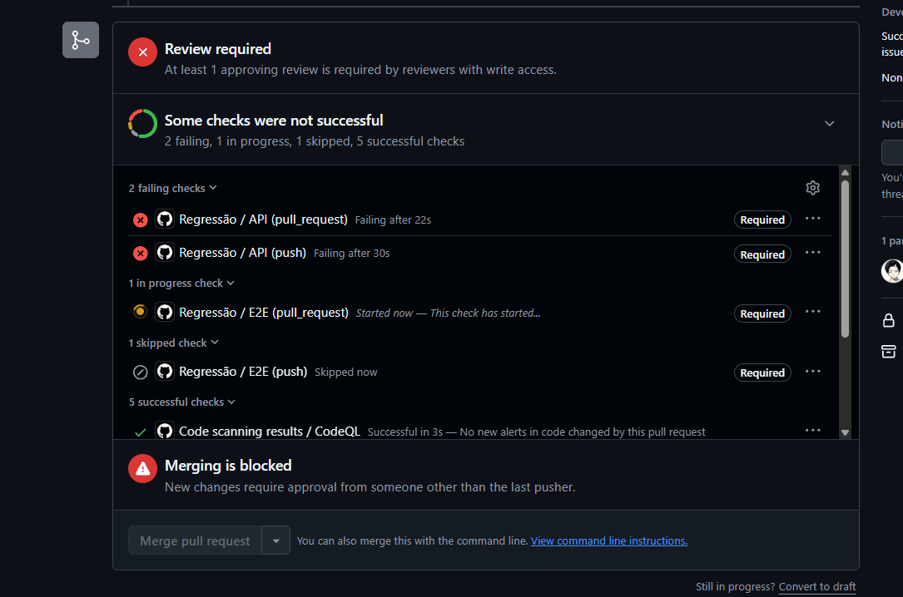
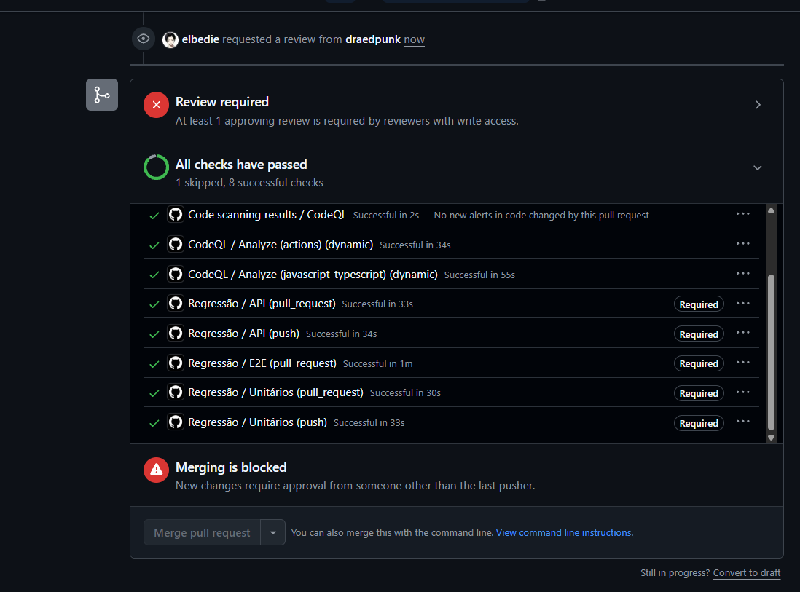
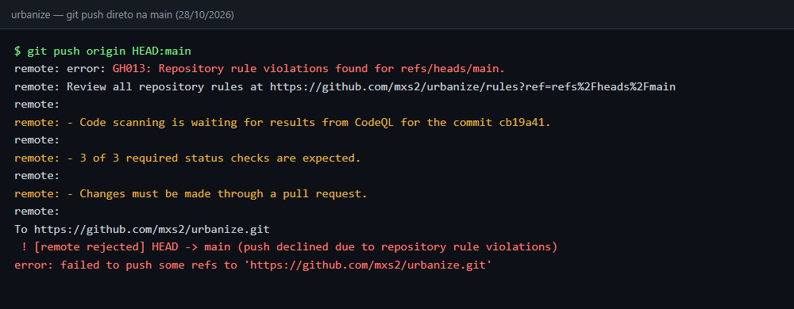

# Entrega — Pipeline de Regressão e Quality Gate

Registra o que a equipe fez em cada item da atividade, onde está configurado e as evidências de execução.

**Legenda:** ✅ completo · 🟡 parcial

## Resumo

| # | Item pedido | Status |
| --- | --- | --- |
| 1 | Revisão do workflow | ✅ |
| 2.1 | Cobertura do backlog de automação | 🟡 66 de 94 casos automatizados; 16 pendentes no backlog |
| 2.2 | Execução diária da regressão completa | ✅ |
| 2.3 | Horário de execução | ✅ |
| 3.1 | A cada push: unitários e API | ✅ |
| 3.2 | Antes de cada merge: unitários, API e 1 a 3 smoke E2E | ✅ |
| 3.3 | Diariamente: suíte completa | ✅ |
| 4.1 | Regra de proteção que impede merge com teste falhando | ✅ |
| 4.2 | Só alterações aprovadas pelas verificações entram na `main` | ✅ |

## 1. Revisão do workflow

O workflow fica em [`.github/workflows/regressao.yml`](../.github/workflows/regressao.yml) e tem três jobs:

| Job | O que roda | Como |
| --- | --- | --- |
| `Unitários` | Testes do app (`tests/unit`) | `npm test` em `mobile/` (Jest + jest-expo) |
| `API` | Testes de API (`tests/acceptance`) e BDD (`tests/bdd`) | Prepara SQLite com migrations e seed; roda `npm test` e `npm run test:bdd` em `backend/` |
| `E2E` | Testes de sistema (`e2e/tests`) | Sobe o backend e o app web exportado pelo Expo; roda Playwright no Chromium |

Melhorias feitas na revisão:

- **Testes separados por etapa (commit `e267d5d`).** Antes havia um único job, "Regressão completa", que rodava tudo
  em qualquer evento, e o push só disparava na `main`. Agora são três jobs com nome próprio, que viraram os checks
  exigidos pelo Quality Gate. O push dispara em qualquer branch, o `E2E` não roda em push, e no PR roda só os testes
  com a tag `@smoke`.
- **Histórico de ajustes anteriores:** Node 24 (`0442f03`), passos que não rodam em cascata quando a instalação falha
  (`0ea06b3`) e agendamento diário (`9a03fed`).
- **Diagnóstico de falha.** O relatório do Playwright é publicado como artefato, e os logs do backend e do app web aparecem no job quando o E2E falha.

## 2. Agendamento da regressão completa

### 2.1 Cobertura do backlog de automação 🟡

O vínculo entre casos de teste, testes implementados e etapa da pipeline está em
[`tests/checklist-implementacao.md`](tests/checklist-implementacao.md). A coluna **Pipeline** diz em que etapa cada
teste roda (`push`, `PR`, `diário`).

| Nível | ✅ | 🟡 | ⬜ | Total |
| --- | --- | --- | --- | --- |
| Integração de componentes | 56 | 3 | 7 | 66 |
| Sistema | 7 | 3 | 14 | 24 |
| Componente | 3 | 0 | 1 | 4 |
| **Total** | **66** | **6** | **22** | **94** |

Dos 28 casos ⬜ e 🟡, 12 ficam em execução manual por decisão do
[plano de testes](tests/plano-de-testes-e-backlog.md#5-seleção-para-automação). Os 16 restantes formam o backlog de
automação pendente:

 Casos | Situação |
--- | --- |
 TC37, TC39, TC54, TC61, TC76, TC77, TC86, TC87 | A fazer (API) |
 TC26, TC62, TC92, TC93, TC94 | A fazer (1 de API, 4 de E2E) |
 TC29 | Depende de decisão: o caso espera status inicial `registrada`, o app cria com `em_analise` |
 TC44, TC82 | Dependem de mudança no app: a API não devolve título e descrição sugeridos; o card de triagem não exibe a categoria |

### 2.2 Execução diária ✅

```yaml
on:
  schedule:
    - cron: '0 2 * * *' # 23h em Brasília
```

No agendamento, o job `E2E` roda a suíte completa, sem o filtro `@smoke`. Últimas execuções agendadas, todas com sucesso:

| Data (UTC) | Início real | Atraso sobre 02:00 UTC | Execução |
| --- | --- | --- | --- |
| 28/10 | 07:43 | 5h43 | [40651920247](https://github.com/mxs2/urbanize/actions/runs/40651920247) |
| 27/10 | 07:02 | 5h02 | [40464671459](https://github.com/mxs2/urbanize/actions/runs/40464671459) |
| 26/10 | 07:13 | 5h13 | [40284462092](https://github.com/mxs2/urbanize/actions/runs/40284462092) |
| 25/10 | 07:06 | 5h06 | [40171526548](https://github.com/mxs2/urbanize/actions/runs/40171526548) |
| 24/10 | 06:40 | 4h40 | [40071141094](https://github.com/mxs2/urbanize/actions/runs/40071141094) |
| 23/10 | 06:44 | 4h44 | [39913351123](https://github.com/mxs2/urbanize/actions/runs/39913351123) |
| 22/10 | 06:49 | 4h49 | [39736378278](https://github.com/mxs2/urbanize/actions/runs/39736378278) |
| 21/10 | 06:47 | 4h47 | [39557655147](https://github.com/mxs2/urbanize/actions/runs/39557655147) |
| 20/10 | 06:51 | 4h51 | [39382827104](https://github.com/mxs2/urbanize/actions/runs/39382827104) |
| 19/10 | 07:06 | 5h06 | [39213879260](https://github.com/mxs2/urbanize/actions/runs/39213879260) |

### 2.3 Horário de execução ✅

O horário escolhido é 23h em Brasília (02:00 UTC), fora do período de desenvolvimento. O cron do GitHub Actions
usa UTC.

A tabela acima mostra a política *best-effort* na prática: nenhuma execução começou às 02:00 UTC. O atraso ficou entre
4h40 e 5h43, e mesmo assim a regressão terminou antes do início do expediente. O workflow também aceita
`workflow_dispatch`, para rodar a suíte completa manualmente se um agendamento não acontecer.

## 3. Testes por etapa ✅

```yaml
on:
  push:
    branches: ['**']
  pull_request:
    branches: [main]
  schedule:
    - cron: '0 2 * * *'
  workflow_dispatch:
```

| Evento | Unitários | API | E2E |
| --- | --- | --- | --- |
| `push` (qualquer branch) | ✅ | ✅ | — (job pulado: `if: github.event_name != 'push'`) |
| `pull_request` para `main` | ✅ | ✅ | Só smoke: `npm test -- --grep @smoke` |
| `schedule` (diário) e `workflow_dispatch` | ✅ | ✅ | Suíte completa |

Testes smoke (2):

- `e2e/tests/registrar-demanda.spec.ts`: cidadão entra, registra uma demanda e a vê na listagem.
- `e2e/tests/gestor-gerencia-demanda.spec.ts`: gestor conduz uma demanda da triagem até "Resolvida".

## 4. Quality Gate ✅

O Quality Gate é configurado no GitHub, e não no repositório, em duas camadas.

### Branch protection rule da `main` (Settings → Branches)

É a camada que impede merge com teste falhando. Ela exige:

- **Status checks obrigatórios:** `Unitários`, `API` e `E2E`. Os nomes são os `name:` dos jobs no workflow.
- **Pull request com 1 aprovação** de alguém com permissão de escrita.
- **Aprovação depois do último push**, dada por alguém que não fez esse push ("New changes require approval from
  someone other than the last pusher").

Configuração lida pela API do GitHub (`gh api repos/mxs2/urbanize/branches/main`):

```json
"required_status_checks": {
  "contexts": ["Unitários", "API", "E2E"],
  "enforcement_level": "non_admins"
}
```

### Ruleset "Hay" (Settings → Rules → Rulesets)

Vale para todas as branches (`~ALL`), está ativo e tem a lista de bypass vazia, ou seja, se aplica também a admins.
Regras aplicadas:

| Regra | Efeito |
| --- | --- |
| Restrict deletions (`deletion`) | Impede apagar a branch |
| Block force pushes (`non_fast_forward`) | Impede reescrever o histórico com force push |
| Require code scanning results (`code_scanning`) | Bloqueia o merge se o CodeQL encontrar alerta de segurança `high_or_higher` ou alerta com severidade `errors` |
| Require status checks to pass (`required_status_checks`) | Exige a branch atualizada com a base antes do merge (`strict`); a lista de checks está vazia, porque os checks de teste são exigidos pela branch protection acima |

O CodeQL roda pelo *default setup* do code scanning (workflows `CodeQL` e `GitHub Advanced Security` na aba Actions),
sem arquivo no repositório. No [PR #42](https://github.com/mxs2/urbanize/pull/42), os checks `Analyze (actions)`,
`Analyze (javascript-typescript)` e `CodeQL` passaram.

### Evidência: merge bloqueado com teste falhando

[PR #42](https://github.com/mxs2/urbanize/pull/42) é uma demonstração com regressão proposital. Ele troca o prefixo
do protocolo de `URB-` para `PROT-` em `backend/src/services/demandService.ts`. O teste de API CT-DEM-01 espera
`URB-xxxxx` e falha.

| Job | Push | Pull request |
| --- | --- | --- |
| Unitários | ✅ | ✅ |
| API | ❌ [log](https://github.com/mxs2/urbanize/actions/runs/40763104755/job/123079967473) | ❌ [log](https://github.com/mxs2/urbanize/actions/runs/40763115182/job/123080003751) |
| E2E | pulado | ❌ [log](https://github.com/mxs2/urbanize/actions/runs/40763115182/job/123080004063) |



O print foi tirado com o E2E ainda em andamento; ele terminou falhando também. O botão **Merge pull request** fica
desabilitado.

### Evidência: checks passando, merge ainda depende de review

[PR #41](https://github.com/mxs2/urbanize/pull/41) automatiza 15 casos do backlog. Todos os checks obrigatórios passaram
(o E2E de push aparece como pulado, como previsto), mas o merge continua bloqueado até outro integrante aprovar.



### Evidência: push direto na `main` recusado

Em 28/10/2026, um integrante sem permissão de admin tentou enviar um commit vazio direto para a `main`
(`git push origin HEAD:main`). O GitHub recusou o push com o erro `GH013` e listou as três regras violadas:

- o CodeQL ainda não tinha resultado para o commit (ruleset "Hay");
- os 3 status checks obrigatórios (`Unitários`, `API` e `E2E`) não tinham rodado;
- alterações na `main` precisam passar por pull request.



### Ponto de atenção

`enforcement_level: non_admins` indica que administradores do repositório não ficam presos à branch protection, então
um admin consegue mergear com teste falhando. O ruleset "Hay" não tem essa brecha, mas não exige os testes. Para
fechar, um admin deve ativar **Do not allow bypassing the above settings** na regra da `main` ou incluir `Unitários`,
`API` e `E2E` nos status checks do ruleset.
