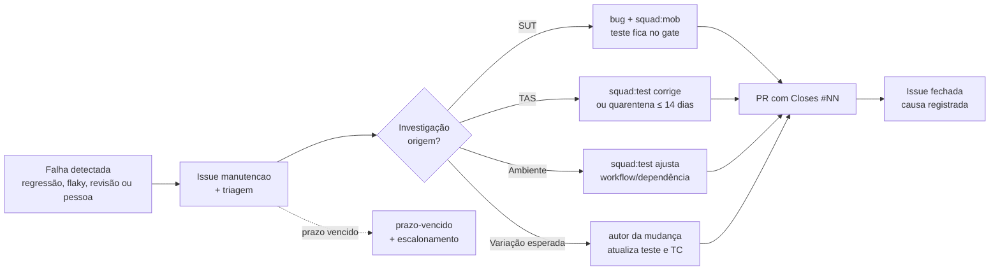

# TAS — Solução de Automação de Testes do Urbanize

Documenta a solução de automação de testes (TAS, *Test Automation Solution*) do Urbanize e a **política de
manutenção** que a equipe segue para mantê-la confiável. A política (seção 3) foi elaborada a partir do Capítulo 13
do material de estudo; os mecanismos que a colocam em prática no GitHub estão na seção 4.

## 1. A TAS em uma página

| Camada | Onde | Ferramenta | Quando roda (pipeline [`regressao.yml`](../.github/workflows/regressao.yml)) |
| --- | --- | --- | --- |
| Unitário (mobile) | `tests/unit/` | Jest + jest-expo | todo push, PR e diária |
| API / aceitação | `tests/acceptance/` | Jest + Supertest (SQLite + seed) | todo push, PR e diária |
| BDD | `tests/bdd/` | Cucumber | todo push, PR e diária |
| E2E | `e2e/tests/` | Playwright (Chromium, app web exportado pelo Expo + backend real) | PR (só `@smoke`) e diária (completa) |

- Cada teste cita no nome o caso que automatiza (`TCxx`, catálogo em
  [casos-de-teste.md](tests/casos-de-teste.md)); é isso que liga teste → caso → história de usuário → prioridade MoSCoW.
- O job **Qualidade** junta os JUnit XML, calcula as métricas ([metricas-de-qualidade.md](tests/metricas-de-qualidade.md))
  e abre issue quando a regressão falha na `main`.
- O Quality Gate (ruleset da `main`) exige os checks `Unitários`, `API` e `E2E` verdes para mergear
  ([entrega-pipeline-quality-gate.md](entrega-pipeline-quality-gate.md)).

## 2. Contexto que orienta as decisões

- **Equipe pequena e acadêmica.** Sete pessoas, uma só com Testes como área primária (Enzo Antuna); Mobile (Diego
  Xavier) cuida do app e da API; PM (Mateus Xavier). Ninguém fica de plantão, e a equipe se reúne **uma vez por semana**
  (issues "Acompanhamento"). Os prazos precisam caber nesse ritmo.
- **A `main` é protegida pelos testes.** Um teste vermelho na `main` bloqueia todos os PRs; isso torna falhas na `main`
  caras e justifica o prazo mais curto.
- **Tudo dentro do GitHub, sem ferramenta paga.** Registro em issues, automação em Actions, sem Jira/Allure/SonarCloud.
- **Dados de teste locais e determinísticos** (SQLite + seed por execução). Falhas intermitentes tendem a vir do E2E
  (rede, tempo de renderização, ordem de eventos), não de unitários e API.
- **Público inclui gestores públicos.** Um defeito escondido por um teste "silenciado" tem custo maior que um PR
  atrasado; por isso a política sempre prefere tratar a falha como defeito real até prova em contrário.

## 3. Política de manutenção

### 3.1 Tratamento de falhas

Toda falha da regressão segue o mesmo caminho: **detectar → registrar → investigar → classificar → encaminhar → fechar**.

**Detectar e registrar.** Falha na `main`, na regressão diária ou em execução manual abre (ou atualiza) automaticamente
uma issue `falha-pipeline` + `manutencao` + `triagem`, já com prioridade P1 e prazo de 1 dia. Teste instável abre issue
`flaky` (P3). Problemas encontrados por pessoas (ou na revisão periódica) entram pelo formulário **Manutenção de
teste**. Em PR, a falha aparece no check vermelho e é do autor do PR; só vira issue se não for causada pelo PR.

**Investigar.** Quem faz a triagem (squad de Testes, ou o autor do último commit na `main`) usa, nesta ordem:

1. O JUnit e a mensagem de erro no Job Summary e na issue.
2. O diff entre a última execução verde e a vermelha (`git log` do intervalo).
3. Os artefatos: log do backend e do app web, trace e screenshot do Playwright, relatório HTML.
4. Reexecução local do teste isolado (`npx playwright test -g "TCxx"` ou `npm test -- -t "TCxx"`).

**Classificar.** A origem é registrada no campo *Origem da falha* da issue e vira label:

| Origem | Como reconhecer | Encaminhamento | Responsável |
| --- | --- | --- | --- |
| **SUT** — defeito no sistema (`origem:sut`) | O comportamento observado contraria o caso de teste/critério de aceite; reproduz manualmente | Issue vira `bug`; correção no código do app/API com o teste existente como prova | Squad Mobile (`squad:mob`); Segurança se for falha de segurança |
| **TAS** — problema na automação (`origem:tas`) | Seletor quebrado, espera mal feita, dado de teste errado, teste dependente de ordem; o app funciona manualmente | Corrigir o teste/helper/seed; se não der no prazo, quarentena (3.3) | Squad de Testes (`squad:test`) |
| **Ambiente** (`origem:ambiente`) | Runner sem rede, `npm ci` falhou, timeout do `wait-on`, serviço externo fora (Google Vision), cache corrompido, job que nem iniciou (cota ou cobrança do Actions) | Reexecutar o job uma vez; persistindo, ajustar o workflow ou isolar a dependência externa | Squad de Testes (dono do workflow) |
| **Variação esperada** (`origem:variacao-esperada`) | O comportamento mudou de propósito (nova regra, texto, layout) e o teste ficou desatualizado | Atualizar teste **e** caso de teste no mesmo PR da mudança; se escapou, o autor da mudança corrige | Autor da mudança (padrão `squad:test`) |

Regras de classificação:

- **Na dúvida entre SUT e TAS, trata-se como SUT** até alguém reproduzir manualmente o comportamento correto. Isso
  evita "consertar o teste" para aceitar um defeito.
- **Ambiente só depois de descartar SUT e TAS.** Reexecutar sem investigar é proibido como primeira resposta: a
  reexecução só vale como diagnóstico, registrada na issue.
- **Variação esperada exige rastro**: a issue/PR que mudou o comportamento precisa ser citada. Sem ele, volta para SUT.
- A classificação pode mudar durante a investigação; basta editar o campo na issue (as labels acompanham).

**Pipeline que não executa também é falha.** Se os jobs nem iniciam (cota, cobrança ou indisponibilidade do GitHub
Actions), nenhum mecanismo automático dispara — inclusive a issue de falha. Por isso a reunião semanal confere o
badge da regressão no README; vermelho sem issue aberta é registrado à mão como *Ambiente*, P1. Enquanto a pipeline
estiver fora, vale a **contingência**: quem vai mergear roda unitários e API localmente e anexa o resultado ao PR
(`scripts/qualidade/relatorios.mjs` e `scripts/manutencao/verificar.mjs` funcionam fora do CI), e o merge precisa de
aprovação do PM, já que o ruleset fica sem checks válidos.

**Fechar.** A issue `falha-pipeline` fecha sozinha quando a regressão completa volta a passar. As demais fecham pelo
PR de correção (`Closes #NN`), com a causa registrada no campo *Encaminhamento*.

### 3.2 Critérios e prazos de correção

| Prioridade | Critério | Triagem (classificar origem) | Correção | Exemplos |
| --- | --- | --- | --- | --- |
| **P1** | Bloqueia a `main` (Quality Gate vermelho) **ou** quebra funcionalidade *Must have* | mesmo dia | **1 dia** | regressão diária vermelha; login quebrado |
| **P2** | Bloqueia PRs sem estar na `main`, ou falha em funcionalidade *Should/Could have* | 1 dia | **3 dias** | E2E smoke falhando por mudança de ambiente |
| **P3** | Teste instável ou em quarentena | 1 dia | **7 dias** (quarentena máx. 14) | teste que só passa na reexecução |
| **P4** | Melhoria da TAS: lentidão, duplicação, rastreabilidade | na revisão mensal | **30 dias** | teste sem `TCxx`; E2E acima de 60 s |

- **Prazos em dias corridos a partir da abertura da issue.** Contar dias úteis automaticamente exigiria calendário
  acadêmico; com reunião semanal, dias corridos são previsíveis para todos. P3 = um ciclo semanal; P4 = um ciclo de
  revisão.
- **Por que P1 é tão curto:** com o Quality Gate, cada dia de `main` vermelha é um dia sem merge para a equipe inteira.
  Se a correção não cabe em 1 dia, a saída aceita é **reverter o commit que quebrou** (não desligar o teste).
- **Responsabilidades:** quem faz a triagem é o squad de Testes; quem corrige é o responsável da origem (tabela 3.1),
  atribuído como *assignee*. Sem assignee, a cobrança diária avisa e o PM atribui na reunião semanal.
- **Prazo vencido:** a issue ganha `prazo-vencido` e um comentário marca o responsável. Ele corrige, ou renegocia o
  prazo **na própria issue, com justificativa**, ou leva para a reunião semanal (escalonamento para o PM).

### 3.3 Gestão de testes instáveis (flaky)

**Definição:** teste que falha e passa sem mudança no código do sistema nem do teste.

**Identificação.**

- No CI o Playwright roda com `retries: 1` **só para diagnóstico**: o teste que falha e passa na segunda tentativa
  continua verde para o gate, mas sai como `flaky` no `resultados.json`, aparece no Job Summary e abre automaticamente
  uma issue `flaky` P3 (uma por teste; nova ocorrência vira comentário). A segunda tentativa grava trace, que é a
  evidência da investigação. Localmente `retries` é 0, para quem desenvolve ver a falha.
- Unitários e API não reexecutam (são determinísticos: SQLite e seed por execução). Falha que some ao reexecutar o job
  é registrada à mão pelo formulário como *Teste instável*.

**Tratamento, sem mascarar defeitos reais.**

1. **Investigar primeiro se é SUT.** Instabilidade é muitas vezes condição de corrida no próprio app (requisição que
   termina fora de ordem, estado não persistido). Se for, a issue vira `origem:sut` e o teste **fica no gate**.
2. **Se for TAS**, corrigir a causa: esperar por condição (`expect(...).toBeVisible()`) em vez de tempo fixo,
   isolar dados (título com `Date.now()`), remover dependência de ordem.
3. **É proibido** como correção: aumentar `retries`, colocar `waitForTimeout`/`sleep`, aumentar timeout sem explicar
   a causa, ou apagar asserção.
4. **Quarentena** só quando a correção não cabe no prazo P3 e o teste está atrapalhando PRs:
   - marcar o título com `@quarentena #NN` (issue P3 aberta) — a verificação da TAS **falha o PR** se faltar a issue;
   - o teste sai do gate (`--grep-invert @quarentena`), mas **continua rodando na regressão diária** em um passo
     separado que não bloqueia; o resultado fica no relatório, para a equipe ver se ele quebrou de vez;
   - duração máxima de **14 dias**; depois disso, corrigir ou abrir pedido de remoção (3.5);
   - se o teste cobre história *Must have*, o caso é executado **manualmente** em cada entrega enquanto estiver em
     quarentena (registrar na issue).
5. Unitário/API instável que precise sair do gate usa `test.skip(... #NN)`; a mesma regra de issue obrigatória vale.

### 3.4 Revisão periódica

**Frequência:** mensal, no dia 1, com issue `revisao-periodica` aberta automaticamente e prazo de 7 dias; conduzida
pelo squad de Testes e fechada na reunião semanal seguinte. Mensal porque um ciclo de entrega da disciplina dura
cerca de um mês e o volume de testes (~100) não justifica revisão semanal; as verificações contínuas abaixo cobrem o
intervalo.

| Critério | O que se avalia | Limite / gatilho | Fonte |
| --- | --- | --- | --- |
| **Instabilidade** | testes `flaky`, quarentenas abertas e sua idade | qualquer `flaky` precisa de issue com responsável; quarentena > 14 dias | issues `flaky`/`quarentena`, `verificar.mjs` |
| **Tempo de execução** | duração por teste e tendência da suíte | unitário > 2 s, API > 5 s, E2E > 60 s por teste; suíte crescendo 3 execuções seguidas | `verificar.mjs`, histórico de métricas (M8/M9) |
| **Duplicação de código** | testes com o mesmo nome; cenários que exercitam o mesmo fluxo; helpers/page objects copiados | nome repetido; dois testes cobrindo o mesmo TC sem motivo | `verificar.mjs` + leitura guiada pelo checklist |
| **Rastreabilidade** | todo teste cita o `TCxx` que automatiza; TCs automatizados batem com o checklist | teste sem `TCxx` | `verificar.mjs`, métrica M4 |
| **Remoções** | todo teste removido no mês tem pedido aprovado | remoção sem issue | check do PR |

Limites justificados pelo que se observa hoje: unitários rodam em milissegundos (2 s já indica I/O indevido), API
chama o `app` em memória (5 s indica espera desnecessária) e o E2E mais longo leva por volta de 30 s (60 s dá folga
sem deixar crescer sem controle). Cada achado vira issue P4 (ou P3, se for instabilidade).

Duplicação de código é avaliada por leitura na revisão, guiada pelos nomes duplicados e pelos TCs cobertos mais de uma
vez; um detector de clones (jscpd) foi considerado, mas acrescentaria dependência para uma base de testes ainda pequena.

### 3.5 Remoção de testes

Um teste automatizado só é descontinuado por um destes motivos:

- funcionalidade removida ou retirada do escopo;
- duplicado: outro teste cobre o mesmo caso no mesmo nível ou em nível mais barato;
- instável sem correção viável depois do prazo de quarentena;
- custo de manutenção maior que o valor, em funcionalidade de baixo risco (*Could have*);
- substituído por teste em outro nível (ex.: E2E trocado por teste de API).

**Não são motivos:** "está falhando" (falha é tratada por 3.1) ou "está lento" (é melhoria P4).

**Quem decide:** um membro do squad de Testes **e** o dono da funcionalidade (squad Mobile; Segurança para testes de
segurança). Para história *Must have*, também o PM. A aprovação é a label `remocao-aprovada` na issue.

**Registro e riscos assumidos:** o formulário **Remoção de teste** exige justificativa, a cobertura que fica (teste
substituto ou execução manual) e o **risco assumido** — o que pode passar sem ser detectado. O PR que remove o teste
precisa citar `Remove teste: #NN`; o check `Verificação da TAS` falha se o PR apagar declarações de teste sem essa
referência ou se a issue não estiver aprovada. No mesmo PR, o caso em
[checklist-implementacao.md](tests/checklist-implementacao.md) volta para manual ou aponta o substituto.

## 4. Como a política é aplicada no GitHub

| Regra | Mecanismo | Onde |
| --- | --- | --- |
| Registrar falhas da regressão | Issue automática `falha-pipeline` com prioridade P1 e prazo | [`regressao.yml`](../.github/workflows/regressao.yml), job Qualidade |
| Registrar testes instáveis | `retries: 1` no CI + `resultados.json` + issue automática `flaky` P3 | [`playwright.config.ts`](../e2e/playwright.config.ts), `regressao.yml` |
| Registrar demandas manuais | Formulários **Manutenção de teste** e **Remoção de teste** | [`.github/ISSUE_TEMPLATE/`](../.github/ISSUE_TEMPLATE/) |
| Classificação, responsáveis e prazo | Workflow lê o formulário e aplica `origem:*`, `prioridade:P*`, `squad:*`, `flaky`/`quarentena` e calcula o prazo | [`manutencao.yml`](../.github/workflows/manutencao.yml), job `classificar` |
| Acompanhar prazos | Cobrança em dias úteis: `prazo-vencido` + menção ao responsável; aviso de triagem parada | `manutencao.yml`, job `prazos` |
| Quarentena sem esconder defeito | `@quarentena #NN` fora do gate, mas rodando em passo separado na diária | `regressao.yml`, passo "Testes em quarentena" |
| Proibir `.only` e teste desligado sem issue | Verificação estática em todo PR e push na `main` | [`scripts/manutencao/verificar.mjs`](../scripts/manutencao/verificar.mjs), job `verificacao` |
| Remoção só com aprovação | Check de PR compara declarações de teste removidas × adicionadas e exige `Remove teste: #NN` aprovada | `manutencao.yml`, job `verificacao` |
| Revisão periódica | Issue mensal com diagnóstico da última regressão (instáveis, lentos, duplicados, sem TCxx) e checklist | `manutencao.yml`, job `revisao` |
| Vocabulário comum | Labels da política | [`scripts/manutencao/labels.sh`](../scripts/manutencao/labels.sh) |
| Lembrete no PR | Checklist de testes no template de PR | [`.github/pull_request_template.md`](../.github/pull_request_template.md) |

Para tornar a verificação obrigatória, o check `Verificação da TAS` deve ser incluído no ruleset da `main`, ao lado de
`Unitários`, `API` e `E2E`.

### Fluxo

